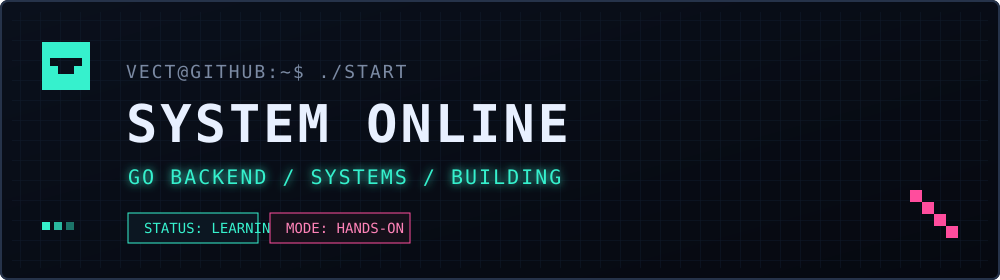

<p align="center">
  
</p>

```text
vect@github:~$ whoami

你好，我是 Vect，主要写 Go。
我也用 C++ 学网络与系统，最近在重新补数据结构、操作系统、
计算机网络和数据库，并开始把 Agent 放进完整的项目流程。
```

## 01 / BUILDS

### [MsgMate](https://github.com/WoAiXueXiHa/MsgMate)

Go 异步通知服务。包含模板、定时任务、消息队列、失败重试和入口限流，是我练习 MySQL、Redis、Kafka 与并发编程的项目。

### [muduo](https://github.com/WoAiXueXiHa/muduo)

基于 Linux epoll 的 C++ Reactor 网络库，并在上面实现了 HTTP 服务。这个项目帮助我理解事件循环、线程模型、TCP 字节流和连接生命周期。

## 02 / CURRENT QUESTS

```text
[>] Go backend & concurrency
[>] Data structures & algorithms
[>] OS / Network / Database
[>] Agent tools / context / sandbox / evals
```

## 03 / RULE

> 如果一段代码还讲不明白，我就继续学。
